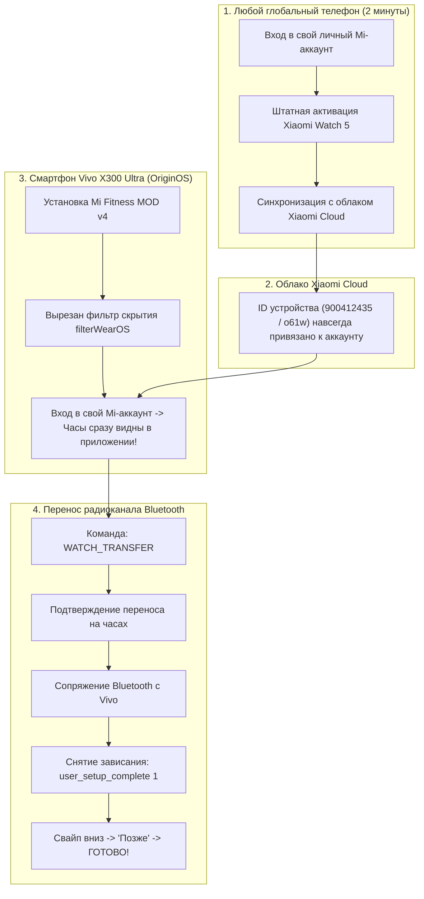

# 👑 ЦАРСКИЙ ГАЙД: Подключение Xiaomi Watch 5 к Vivo X300 Ultra (OriginOS)

[](https://github.com/kaiser10669-svg)
[-00E676?style=for-the-badge&logo=vivo)](https://github.com/kaiser10669-svg)
[-FF6D00?style=for-the-badge&logo=xiaomi)](https://github.com/kaiser10669-svg)
[](https://github.com/kaiser10669-svg)
[](LICENSE)

> [!NOTE]
> **Эксклюзивный рабочий метод от Kaiser Dev.**  
> Данная инструкция решает фундаментальную проблему несовместимости глобальных смарт-часов **Xiaomi Watch 5** (Google Wear OS 5 / Android 16) и китайской флагманской прошивки **Vivo OriginOS 5** (Android 15–16) без сброса часов к заводским настройкам и без модификации системного раздела смартфона.

---

## 🧭 Архитектура обхода: Почему это работает?



---

## 🔬 В чем корень проблемы сопряжения «с нуля» через «+»?

1. **Xiaomi Watch 5** базируются на операционной системе **Google Wear OS**. Мастер сопряжения официального Mi Fitness при нажатии на «+» (Добавить устройство) вызывает внутренний API Google Play Services: `Wearable.API` (`ConnectionClient`).
2. В китайских прошивках **OriginOS** сервисы Google работают в урезанном «CN-режиме» — системный сервис `com.google.android.gms.wearable` на уровне Google заблокирован для вызовов со стороны сторонних китайских вендоров.
3. При попытке сопряжения напрямую через «+» приложение Mi Fitness на Vivo выдаёт:
   ```text
   ApiException: 17: API: Wearable.API is not available on this device.
   ```
   В результате часы либо не обнаруживаются вовсе, либо выдают бесконечную ошибку подключения.

### 💡 Решение от Kaiser:
* **Облачный мост**: Часы единожды регистрируются в аккаунте Xiaomi через любой глобальный телефон.
* **Мод Mi Fitness v4**: В модифицированном приложении полностью декомпилирован и вырезан фильтр `filterWearOS`, поэтому OriginOS больше не скрывает часы, и они моментально подгружаются из аккаунта.
* **Перенос связи без сброса**: Специальные команды Android переключают Bluetooth-канал часов на Vivo и снимают экран блокировки мастера настройки.

---

## 📦 Состав комплекта

| Файл / Папка | Назначение |
| :--- | :--- |
| `1_Mi_Fitness_Mod_v4/` | Модифицированный Mi Fitness (RU + ARM64). Снят фильтр Wear OS, разблокированы графики ЭКГ, анализ аритмии, сосуды, давление, температура кожи. |
| `2_Kaiser_Link_WiFi_File_Transfer/` | Сверхскоростной беспроводной мост по Wi-Fi (до 40 МБ/с) для передачи музыки (.mp3) и файлов на часы без паразитных вибраций Wear OS. |
| `WatchThermometer.apk` | Нативный виджет температуры тела и кожи для рабочего стола часов. |
| `do_pair_from_pc.bat` | Автоматический скрипт переноса часов с ПК в один клик. |
| `pair_watch_from_phone.sh` | Скрипт переноса прямо со смартфона Vivo через Bugjaeger / Termux. |
| `tools/` | Автономный портативный ADB (установка сторонних программ на ПК не требуется). |

---

## 🚀 ШАГ 1: Однократная привязка к облаку (2 минуты)

> [!TIP]
> Подойдет **абсолютно любой** телефон с глобальной прошивкой (старый смартфон, телефон друга, планшет Xiaomi, Samsung, Google Pixel, Realme Global и т.д.).

1. Включите VPN на глобальном телефоне.
2. Установите официальный **Mi Fitness** и войдите под своим **личным Mi-аккаунтом**.
3. Подключите часы **Xiaomi Watch 5** штатным способом.
4. Дождитесь полной синхронизации и убедитесь, что часы отображаются в личном кабинете.
5. **Поздравляем!** Теперь идентификатор часов навсегда прописан в облаке Xiaomi Cloud за вашим профилем. Глобальный телефон больше не нужен.

---

## 📲 ШАГ 2: Установка Mi Fitness MOD v4 на Vivo X300 Ultra

1. **Включите режим разработчика на Vivo X300 Ultra**:
   * *Настройки* → *О телефоне* → *Сведения о ПО* → 7 раз нажмите на **«Номер сборки»**.
   * *Настройки* → *Система* → *Для разработчиков* → включите **«Отладка по USB»**.
2. Установите модифицированный комплект из папки `1_Mi_Fitness_Mod_v4` (`install_phone_mod.bat`).
3. Включите VPN на Vivo X300 Ultra.
4. Откройте **Mi Fitness MOD v4** и войдите в свой **тот же самый Mi-аккаунт**.
5. Перейдите во вкладку **«Устройство»**: ваши часы **Xiaomi Watch 5 уже находятся в списке!**

### ⚠️ Жизненно важная настройка OriginOS (чтобы связь не засыпала):
* Зажмите иконку **Mi Fitness** на рабочем столе → **«О приложении»**.
* **Управление батареей** → переключите на **«Высокое энергопотребление в фоне»** *(Разрешить работу без ограничений)*.
* **Автозапуск** → включите **«Автозапуск»** и **«Ассоциированный запуск»**.
* **Разрешения** → разрешите **Доступ к уведомлениям**, **Устройства поблизости (Bluetooth)**, **Местоположение (Всегда)**.
* Откройте меню недавних приложений и заблокируйте Mi Fitness **замочком 🔒**.

---

## ⚡ ШАГ 3: Перенос радиоканала часов на Vivo (Сопряжение)

### Способ А: Прямо со смартфона Vivo (Без компьютера)
1. Установите на Vivo бесплатное приложение **Bugjaeger** (из Google Play или APK).
2. На часах откройте: *Настройки* → *Для разработчиков* → включите **«Отладка по Wi-Fi»** *(часы и телефон в одной Wi-Fi сети)*.
3. Запомните IP-адрес и порт часов (например, `192.168.1.57:5555`).
4. В приложении Bugjaeger нажмите иконку штекера 🔌, введите адрес часов и нажмите **Connect**.
5. Перейдите на вкладку **Commands** (или **Shell**) и отправьте команду активации переноса:
   ```bash
   am start -a android.settings.WATCH_TRANSFER
   ```
6. **Взгляните на часы**: на экране появится системный запрос:  
   *«Подтвердить перенос на новый телефон?»* → **нажмите зеленую галочку [✓]**.
7. На смартфоне Vivo в шторке или в Mi Fitness появится запрос сопряжения Bluetooth → нажмите **«Подключить»** / **«Создать пару»**.
8. **ВНИМАНИЕ! КЛЮЧЕВОЙ МОМЕНТ ОБХОДА ЗАВИСАНИЯ:**  
   На часах появится надпись: *«Продолжите на телефоне»*. Нажимать на экране часов ничего не нужно!  
   Снова перейдите в **Bugjaeger** (переподключитесь, если соединение сбросилось) и выполните две команды:
   ```bash
   settings put secure user_setup_complete 1
   am start -a android.intent.action.MAIN -c android.intent.category.HOME
   ```
9. Часы моментально выйдут из бесконечного ожидания на экран сопряжения.  
   **Свайпом пролистните экран вниз и нажмите кнопку «Позже».**
10. **🎉 ГОТОВО!** Часы переходят на главный циферблат. Облачный значок перечеркнутого телефона исчезает. Связь активна, шаги, пульс и пуши летят на Vivo!

---

### Способ Б: В один клик через компьютер (Скрипт .BAT)
1. Включите **«Отладку по Wi-Fi»** на часах.
2. Запустите файл `do_pair_from_pc.bat`.
3. Введите IP часов.
4. На часах подтвердите перенос кнопкой **[✓]**, на Vivo подтвердите Bluetooth-сопряжение.
5. При появлении надписи *«Продолжите на телефоне»* скрипт автоматически отправит команды фикса и вернет часы на главный экран. Нажмите на часах **«Позже»**.

---

## 🎵 ШАГ 4: Сверхбыстрая передача музыки и файлов (Kaiser Link)

1. В папке `2_Kaiser_Link_WiFi_File_Transfer` запустите:
   * `install_to_phone.bat` (клиент на телефон).
   * `install_to_watch.bat` (клиент без паразитных вибраций на часы).
2. Запустите Kaiser Link на часах и телефоне.
3. Закидывайте любые `.mp3` треки, аудиокниги и файлы целыми папками со скоростью до **40 МБ/с**!

---

## 🌡️ ШАГ 5: Нативный термометр для экрана часов

В пак включен `WatchThermometer.apk`:
* Отображает реальную температуру с подкожного термосенсора Xiaomi Watch 5.
* Добавляется в виде плитки быстрого доступа (Tile) или осложнения (Complication) на любой циферблат.
* Установка: через ПК командой `install_watch_thermometer.bat` либо через Bugjaeger.

---

## ❓ Часто задаваемые вопросы (FAQ)

<details>
<summary><b>1. Слетит ли сопряжение при перезагрузке Vivo или часов?</b></summary>
Нет! Сопряжение сохраняется на уровне аппаратных Bluetooth-ключей (LTK) и защищенного хранилища. После перезагрузки связь восстанавливается автоматически за 2–3 секунды.
</details>

<details>
<summary><b>2. Приходят ли звонки и уведомления?</b></summary>
Да! Приходят входящие вызовы с отображением имени контакта, SMS, сообщения из Telegram, WhatsApp, банковских приложений и любых других служб.
</details>

<details>
<summary><b>3. Работает ли мониторинг здоровья (ЭКГ, пульс, сон)?</b></summary>
В Mi Fitness MOD v4 активированы расширенные алгоритмы: графики ЭКГ высокого разрешения, детекция мерцательной аритмии, пульсовая волна, жесткость сосудов и мониторинг сна со всеми фазами.
</details>

---

## 👑 Авторство
* **Автор решения и модификаций:** [Kaiser Dev](https://github.com/kaiser10669-svg)
* Специально для сообщества 4PDA и владельцев связки Vivo X300 Ultra + Xiaomi Watch 5.
