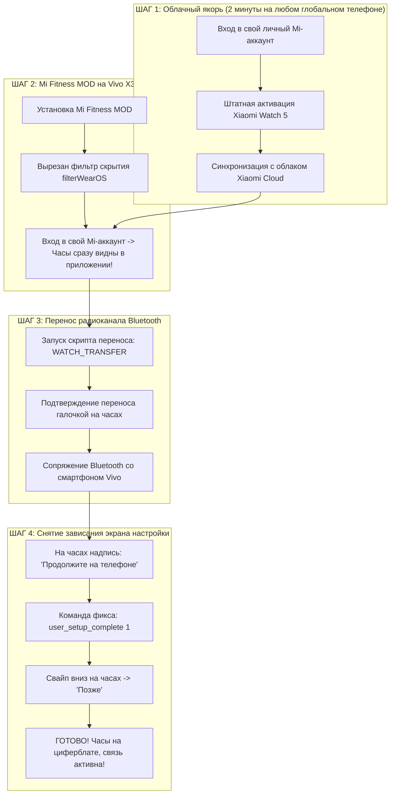

# 👑 KaiserWear: Подключение Xiaomi Watch 5 к Vivo X300 Ultra (OriginOS)

[](https://github.com/kaiser10669-svg)
[-00E676?style=for-the-badge&logo=vivo)](https://github.com/kaiser10669-svg)
[-FF6D00?style=for-the-badge&logo=xiaomi)](https://github.com/kaiser10669-svg)
[](https://github.com/kaiser10669-svg)
[](LICENSE)

> [!NOTE]
> **Официальный рабочий метод и софт от Kaiser Dev.**  
> Полный комплект программ и пошаговое руководство для сопряжения умных часов **Xiaomi Watch 5** (Google Wear OS 5 / Android 16) с китайским флагманом **Vivo X300 Ultra** (OriginOS 5 / Android 15–16) **без сброса часов к заводским настройкам** и без рутирования.

---

## 🧭 В чем корень проблемы сопряжения через «+» в OriginOS?

1. **Часы Xiaomi Watch 5** работают под управлением операционной системы **Google Wear OS**. При попытке добавить часы через стандартный «+» официальный Mi Fitness обращается к сервису Google Play: `Wearable.API` (`ConnectionClient`).
2. В китайской прошивке **OriginOS** сервисы Google функционируют в урезанном режиме: модуль `Wearable.API` на серверах Google для устройств китайского региона заблокирован.
3. Попытка сопряжения «с нуля» выдает системную ошибку:
   ```text
   ApiException: 17: API: Wearable.API is not available on this device.
   ```
   В результате часы либо не обнаруживаются, либо висят в бесконечной ошибке.



---

## 📦 Состав программного пакета

В репозиторий включены все необходимые утилиты автоматизации и портативный ADB:

| Файл / Инструмент | Назначение |
| :--- | :--- |
| **`pair_watch_pc.bat`** | Автоматизированный перенос сопряжения часов с ПК в один клик. Включает автоматическое снятие зависания «Продолжите на телефоне». |
| **`pair_watch_phone.sh`** | Скрипт для сопряжения прямо со смартфона Vivo через приложение Bugjaeger или Termux. |
| **`install_phone_mod.bat`** | Скрипт быстрой пакетной установки модифицированного Mi Fitness MOD на смартфон. |
| **`tools/`** | Автономный портативный ADB (готовые драйверы и библиотеки, установка сторонних программ на ПК не требуется). |
| **[`ИНСТРУКЦИЯ_ПО_ПОДКЛЮЧЕНИЮ.txt`](ИНСТРУКЦИЯ_ПО_ПОДКЛЮЧЕНИЮ.txt)** | Оффлайн текстовая инструкция для чтения и отправки в мессенджерах. |

---

## 🚀 ПОЛНОЕ ПОШАГОВОЕ РУКОВОДСТВО

### ШАГ 1: Однократная привязка к облаку Xiaomi Cloud (2 минуты)
> [!TIP]
> Подойдет **абсолютно любой** телефон с глобальной прошивкой (старый смартфон, телефон друга/члена семьи, планшет Xiaomi, Samsung, Google Pixel, Realme Global и т.д.).

1. Включите VPN на глобальном телефоне.
2. Установите официальный **Mi Fitness** и войдите под своим **личным Mi-аккаунтом**.
3. Подключите часы **Xiaomi Watch 5** штатным способом.
4. В настройках приложения проведите синхронизацию, чтобы часы зафиксировались за вашим аккаунтом.
5. **Готово!** Теперь часы навсегда привязаны к вашему Xiaomi Cloud. Глобальный телефон больше не нужен.

---

### ШАГ 2: Установка Mi Fitness MOD на Vivo X300 Ultra

1. **Включите режим разработчика на Vivo**:
   * *Настройки* → *О телефоне* → *Сведения о ПО* → 7 раз нажмите на **«Номер сборки»**.
   * *Настройки* → *Система* → *Для разработчиков* → включите **«Отладка по USB»**.
2. Подключите Vivo кабелем к ПК и запустите **`install_phone_mod.bat`** (или установите сплиты через Bugjaeger / SAI).
3. Включите VPN на телефоне-глобале и на своем телефоне Vivo.
4. Откройте установленный **Mi Fitness MOD** и войдите под своим **тем же самым Mi-аккаунтом**.
5. Откройте вкладку **«Устройство»**: ваши часы **Xiaomi Watch 5 уже находятся в вашем списке устройств!** (потому что в моде вырезан фильтр `filterWearOS`, скрывавший часы на OriginOS).

#### ⚠️ ОБЯЗАТЕЛЬНАЯ НАСТРОЙКА ORIGINOS (чтобы связь не засыпала):
* Зажмите иконку **Mi Fitness** на рабочем столе → **«О приложении»**.
* **Управление батареей** → переключите на **«Высокое энергопотребление в фоне»** *(Без ограничений)*.
* **Автозапуск** → включите **Автозапуск** и **Ассоциированный запуск**.
* **Разрешения** → разрешите доступ к уведомлениям и устройствам поблизости (Bluetooth).
* В меню недавних приложений закрепите карточку Mi Fitness **замочком 🔒**.

---

### ШАГ 3: Перенос радиоканала на Vivo (Сопряжение)

#### Вариант А: В один клик через компьютер (`pair_watch_pc.bat`)
1. На часах откройте: *Настройки → Для разработчиков → включите «Отладка по Wi-Fi»* (часы и ПК в одной Wi-Fi сети).
2. Запустите скрипт **`pair_watch_pc.bat`** и введите IP-адрес часов.
3. На экране часов появится запрос *«Подтвердить перенос на новый телефон?»* → нажмите зеленую галочку **[✓]**.
4. На смартфоне Vivo в Mi Fitness или шторке подтвердите Bluetooth-сопряжение (**«Подключить»**).
5. На часах появится надпись: *«Продолжите на телефоне»*.  
   **Просто нажмите пробел в окне скрипта на ПК!** Скрипт мгновенно отправит команды обхода блокировки.
6. На экране часов **свайпом вниз пролистните экран и нажмите «Позже»**.
7. **🎉 ГОТОВО!** Часы выйдут на циферблат. Облачный значок перечеркнутого телефона исчезнет, звонки, уведомления и синхронизация активны!

---

#### Вариант Б: Прямо со смартфона Vivo без ПК (`pair_watch_phone.sh`)
1. Установите на Vivo бесплатное приложение **Bugjaeger** (из Google Play или APK).
2. На часах включите **«Отладку по Wi-Fi»**.
3. В Bugjaeger введите IP:порт часов и нажмите **Connect**.
4. Во вкладке **Commands** (или Shell) введите команду:
   ```bash
   am start -a android.settings.WATCH_TRANSFER
   ```
5. На часах нажмите галочку **[✓]** (Подтвердить перенос).
6. На Vivo подтвердите сопряжение Bluetooth.
7. **КЛЮЧЕВОЙ МОМЕНТ (Снятие зависания):**  
   Когда на часах появится экран *«Продолжите на телефоне»*, ничего на часах не нажимайте!  
   В Bugjaeger отправьте две команды:
   ```bash
   settings put secure user_setup_complete 1
   am start -a android.intent.action.MAIN -c android.intent.category.HOME
   ```
8. Экран настройки закроется. На часах **свайпом вниз нажмите «Позже»**.
9. **Всё подключено и работает!**

---

## ❓ Часто задаваемые вопросы (FAQ)

<details>
<summary><b>1. Слетит ли сопряжение при перезагрузке Vivo или часов?</b></summary>
Нет! Сопряжение сохраняется на аппаратном уровне Bluetooth-ключей (LTK). После перезагрузки связь восстанавливается автоматически за пару секунд.
</details>

<details>
<summary><b>2. Приходят ли входящие вызовы и уведомления?</b></summary>
Да! Приходят все уведомления (Telegram, WhatsApp, SMS, банковские приложения) и вызовы с отображением имени абонента.
</details>

<details>
<summary><b>3. Работает ли синхронизация пульса, шагов и сна?</b></summary>
Да, все биометрические данные автоматически синхронизируются с Mi Fitness MOD на телефоне.
</details>

---

## 👑 Авторство и благодарности
* **Автор решения и комплекта:** [Kaiser Dev](https://github.com/kaiser10669-svg)
* **Тестирование и проверка в боевых условиях:** **VerbaMraz** (100% подтверждена стабильная работа на реальном устройстве)
* Специально для сообщества 4PDA и владельцев связки Vivo X300 Ultra + Xiaomi Watch 5.
* **Пост на 4PDA:** [`4PDA_POST.txt`](4PDA_POST.txt)
