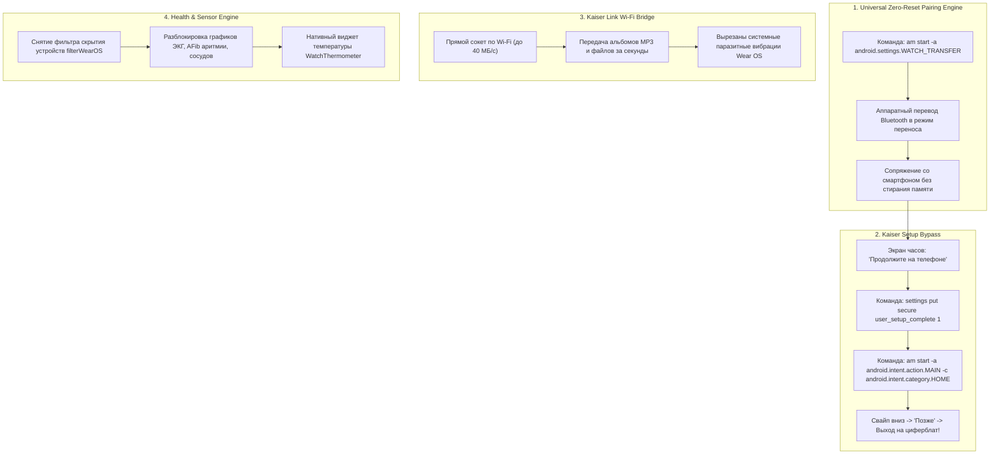

# 👑 KaiserWear Suite: Universal Wear OS Toolkit

[](https://github.com/kaiser10669-svg)
[](https://github.com/kaiser10669-svg)
[](https://github.com/kaiser10669-svg)
[](https://github.com/kaiser10669-svg)
[](LICENSE)

> [!NOTE]
> **Универсальный программный комплекс от Kaiser Dev.**  
> Полноценный инструментарий для сопряжения, разблокировки и скоростного взаимодействия **любых смарт-часов на Wear OS** с китайскими смартфонами на **OriginOS, ColorOS, HyperOS (CN), HarmonyOS** без сброса к заводским настройкам (Zero-Reset Pairing) и без потери данных.

---

## ⌚ Поддерживаемые устройства

### 🕒 Смарт-часы (Wear OS):
* **Xiaomi**: Xiaomi Watch 5, Xiaomi Watch 2, Xiaomi Watch 2 Pro.
* **Samsung Galaxy Watch**: Watch 4, Watch 5 / Pro, Watch 6 / Classic, Watch 7, Watch Ultra.
* **Google**: Pixel Watch 1, Pixel Watch 2, Pixel Watch 3.
* **OnePlus / OPPO**: OnePlus Watch 2, OnePlus Watch 2R, OPPO Watch X.
* **Mobvoi**: TicWatch Pro 3 Ultra, TicWatch Pro 5 / Enduro.

### 📱 Смартфоны:
* **Vivo / iQOO**: OriginOS 3, 4, 5 (Vivo X300 Ultra, X200, X100, iQOO 12, iQOO 13 и др.).
* **OPPO / Realme / OnePlus (CN)**: ColorOS 13, 14, 15.
* **Xiaomi / Redmi (CN)**: HyperOS China.
* **Huawei / Honor (CN)**: HarmonyOS / MagicOS.

---

## 🧭 Архитектура работы: В чем секрет?



---

## 📦 Модули программного комплекса

| Модуль | Файлы | Назначение |
| :--- | :--- | :--- |
| **Universal Pairing Engine** | `pair_watch_pc.bat`<br>`pair_watch_phone.sh` | Автоматизированный перенос сопряжения часов без сброса памяти с ПК или со смартфона. |
| **Kaiser Link Wi-Fi Bridge** | `modules/kaiser-link/` | Беспроводной мост (Phone + Watch APK) для мгновенной передачи музыки и файлов по Wi-Fi. |
| **Health & Device Unlocker** | `modules/mi-fitness-mod/` | Патч Mi Fitness v4: отображение скрытых Wear OS часов, разблокировка ЭКГ, давления, аритмии. |
| **Watch Thermometer** | `modules/thermometer/` | Нативный тайл / осложнение температуры подкожного сенсора часов. |
| **Portable ADB Toolkit** | `tools/` | Автономный портативный ADB (драйверы и библиотеки включены, установка не требуется). |

---

## ⚡ Инструкция по сопряжению часов (За 3 минуты)

### Способ 1: В один клик через компьютер (`pair_watch_pc.bat`)
1. На часах включите: *Настройки → Для разработчиков → Отладка по Wi-Fi*.
2. Убедитесь, что часы и ПК находятся в одной Wi-Fi сети.
3. Запустите **`pair_watch_pc.bat`** и введите IP-адрес часов.
4. Нажмите зеленую галочку **[✓]** на экране часов и подтвердите сопряжение Bluetooth на смартфоне.
5. При появлении на часах экрана *«Продолжите на телефоне»* нажмите пробел в окне скрипта на ПК.
6. На часах свайпните экран вниз и нажмите **«Позже»**.  
   **Готово! Часы мгновенно выходят на циферблат с активным подключением!**

---

### Способ 2: Прямо со смартфона без ПК (`pair_watch_phone.sh`)
1. Установите на телефон приложение **Bugjaeger** (из Google Play или APK).
2. На часах включите **«Отладку по Wi-Fi»**.
3. В Bugjaeger введите IP:порт часов и нажмите **Connect**.
4. Во вкладке **Commands** (или Shell) введите команду:
   ```bash
   am start -a android.settings.WATCH_TRANSFER
   ```
5. Подтвердите перенос на часах **[✓]** и сопряжение на смартфоне.
6. Когда на часах появится экран *«Продолжите на телефоне»*, отправьте две команды снятия зависания:
   ```bash
   settings put secure user_setup_complete 1
   am start -a android.intent.action.MAIN -c android.intent.category.HOME
   ```
7. Свайпом вниз на часах нажмите **«Позже»**. Часы сопряжены и работают!

---

## 📱 Настройка OriginOS / ColorOS для стабильной связи

Чтобы китайская оболочка не усыпляла службу связи в фоновом режиме:
1. Зажмите иконку приложения часов (Mi Fitness / Galaxy Wearable) → **«О приложении»**.
2. **Управление батареей** → переключите на **«Высокое энергопотребление в фоне»** *(Без ограничений)*.
3. **Автозапуск** → включите **«Автозапуск»** и **«Ассоциированный запуск»**.
4. Разрешите доступ к уведомлениям и устройствам поблизости (Bluetooth).
5. В меню недавних приложений закрепите приложение **замочком 🔒**.

---

## 🎵 Модуль Kaiser Link: Передача музыки по Wi-Fi

Обычная отправка музыки по Bluetooth занимает вечность. Модуль **Kaiser Link** решает эту проблему:
1. Установите `kaiser-link-phone.apk` на смартфон и `kaiser-link-watch.apk` на часы (скрипты `install_to_phone.bat` и `install_to_watch.bat` в папке `modules/kaiser-link/`).
2. В приложении на смартфоне выберите треки `.mp3` или аудиокниги.
3. Передача на часы осуществляется по Wi-Fi со скоростью до **40 МБ/с** без лишних системных вибраций!

---

## 👑 Авторство и сообщество
* **Разработчик комплекса:** [Kaiser Dev](https://github.com/kaiser10669-svg)
* Проект открыт для сообществ 4PDA, XDA Developers и всех владельцев китайских флагманов.
